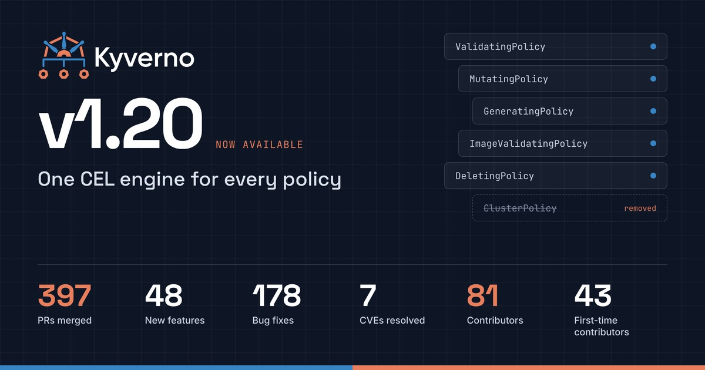

We're excited to announce **Kyverno 1.20**, the first release where the CEL-based policy types are _the_ way to write Kyverno policy. In 1.19 the CEL types reached full feature parity with `ClusterPolicy`; in 1.20 they replace the legacy `ClusterPolicy` and `CleanupPolicy` types outright.

Around that milestone, 1.20 adds private Sigstore and GitHub attestation support for image verification, a much more capable CLI, explainable decisions, richer policy exceptions, and JSON mutation for object-rooted JSON documents, including Terraform plans.

## TL;DR

- **CEL policy types replace** legacy `ClusterPolicy` and `CleanupPolicy`
- **Image verification** with private Sigstore deployments and GitHub artifact attestations
- **CLI**: `kyverno test` supports mocks, `apiCall` and context; new `kyverno oci` packages policy sets
- **Decision log**: `kyverno apply --explain` shows why a CEL decision was made
- **Policy exceptions** gain expiration, metadata and compensating controls
- **JSON mutation** for JSON documents with object roots, including Terraform plans
- **Simpler GeneratingPolicy** with inline YAML templates
- Supports **Kubernetes v1.34 to v1.37**

## CEL policy types are now the only engine

Kyverno 1.20 completes the transition that started in 1.14: the legacy `kyverno.io` policy engine is gone. `ClusterPolicy`, `Policy`, `CleanupPolicy`, `ClusterCleanupPolicy` and the legacy `kyverno.io` `PolicyException` no longer execute in any Kyverno controller or in the CLI.

| Legacy type                              | Replace with                                                                           |
| ---------------------------------------- | -------------------------------------------------------------------------------------- |
| `validate` rules                         | [ValidatingPolicy](https://kyverno.io/docs/policy-types/validating-policy/)            |
| `mutate` rules                           | [MutatingPolicy](https://kyverno.io/docs/policy-types/mutating-policy/)                |
| `generate` rules                         | [GeneratingPolicy](https://kyverno.io/docs/policy-types/generating-policy/)            |
| `verifyImages` rules                     | [ImageValidatingPolicy](https://kyverno.io/docs/policy-types/image-validating-policy/) |
| `CleanupPolicy` / `ClusterCleanupPolicy` | [DeletingPolicy](https://kyverno.io/docs/policy-types/deleting-policy/)                |
| `kyverno.io` `PolicyException`           | `policies.kyverno.io` [PolicyException](https://kyverno.io/docs/guides/exceptions/)    |

Each type also has a namespaced variant, such as `NamespacedValidatingPolicy`, for namespace-scoped policy management.

What changes in 1.20:

- **Legacy execution removed** from the admission, background and reports controllers, and the legacy engine and Go API are deleted ([#18164](https://github.com/kyverno/kyverno/pull/18164), [#18187](https://github.com/kyverno/kyverno/pull/18187), [#18195](https://github.com/kyverno/kyverno/pull/18195), [#18265](https://github.com/kyverno/kyverno/pull/18265), [#18282](https://github.com/kyverno/kyverno/pull/18282)).
- **Creates and spec updates of legacy policies are blocked** ([#17535](https://github.com/kyverno/kyverno/pull/17535)), and the CLI rejects legacy manifests in `apply` and `test` unconditionally ([#17553](https://github.com/kyverno/kyverno/pull/17553)). The CLI has no escape hatch; if you still need to evaluate legacy policies, use a pre-1.20 CLI.
- **Your existing objects are preserved.** The legacy CRD schemas are frozen and protected from Helm prune ([#17494](https://github.com/kyverno/kyverno/pull/17494), [#18231](https://github.com/kyverno/kyverno/pull/18231)), so a stray upgrade does not delete policies you haven't migrated yet. They show as not ready instead of silently enforcing.
- **Guardrails on upgrade.** The Helm chart adds a default-on gate that stops an install or upgrade while legacy policy resources exist ([#17534](https://github.com/kyverno/kyverno/pull/17534)). Kyverno reports any remaining legacy policies on startup and through metrics ([#17519](https://github.com/kyverno/kyverno/pull/17519)) and warns about orphaned legacy webhook configurations ([#17678](https://github.com/kyverno/kyverno/pull/17678)).

The legacy CRDs themselves are planned for full removal in **v1.21**. The `GlobalContextEntry`, `UpdateRequest` and policy report APIs remain, but legacy data in them does not survive the upgrade: results from legacy policies are pruned from reports, reports that only hold legacy results are deleted ([#18195](https://github.com/kyverno/kyverno/pull/18195)), and outstanding legacy `UpdateRequest` objects are deleted rather than processed ([#18187](https://github.com/kyverno/kyverno/pull/18187)). Export any report history you need before you upgrade, and expect queued legacy generate and mutate-existing work not to finish.

## Image verification: more sources, stronger guarantees

`ImageValidatingPolicy` now verifies against **private Sigstore deployments** and **GitHub artifact attestations**, so teams running their own Fulcio and Rekor, or relying on GitHub's build provenance, can enforce it at admission without workarounds.

Alongside that, 1.20 hardens and speeds up the verification path:

- **Keyless signing extensions**: match on `additionalExtensions` in Fulcio certificates ([#17813](https://github.com/kyverno/kyverno/pull/17813)).
- **Cosign v2 and v3** annotations and multiple attestation versions are handled correctly ([#17794](https://github.com/kyverno/kyverno/pull/17794), [#18010](https://github.com/kyverno/kyverno/pull/18010)), and the newest attestation is the one evaluated ([#18049](https://github.com/kyverno/kyverno/pull/18049)).
- **Fail closed**: unverified referrers are rejected ([#18387](https://github.com/kyverno/kyverno/pull/18387)), and cache entries are bound to the content and attestors they verified ([#17993](https://github.com/kyverno/kyverno/pull/17993)).
- **Tenant isolation**: registry credentials for namespaced image policies are scoped to their namespace ([#17923](https://github.com/kyverno/kyverno/pull/17923)).
- **Faster admission**: policies are evaluated concurrently ([#17496](https://github.com/kyverno/kyverno/pull/17496)), compiled CEL programs are reused ([#17599](https://github.com/kyverno/kyverno/pull/17599)) and cache hits skip the registry ([#17974](https://github.com/kyverno/kyverno/pull/17974)).
- **Better diagnostics** for Notary verification in the CLI ([#17902](https://github.com/kyverno/kyverno/pull/17902)) and clearer Cosign errors ([#17606](https://github.com/kyverno/kyverno/pull/17606)).

For a real-world look at attestation-driven admission, see AT&T and Nirmata's KubeCon NA 2026 talk, _Signed, Sealed, Denied_.

## A CLI built for policy pipelines

The Kyverno CLI is where most teams write and test policy, and 1.20 gives it three big upgrades.

**Package policy sets with `kyverno oci`.** 1.20 defines an OCI bundle format for CEL policies ([#17777](https://github.com/kyverno/kyverno/pull/17777)), so a set of policies can be versioned, signed and distributed like any other artifact. New subcommands validate a bundle with CEL-aware checks, inspect it and resolve its named sets ([#18422](https://github.com/kyverno/kyverno/pull/18422), [#18423](https://github.com/kyverno/kyverno/pull/18423)), and `kyverno test` and `kyverno apply` can run directly against OCI bundles ([#17689](https://github.com/kyverno/kyverno/pull/17689)).

**Richer tests.** `kyverno test` supports mocks, `apiCall` and context, so policies that look up live data can be tested offline and in CI. Tests now fail correctly on `messageExpression` errors ([#17863](https://github.com/kyverno/kyverno/pull/17863)), and compiled CEL providers are reused across resources for faster runs ([#18277](https://github.com/kyverno/kyverno/pull/18277)).

**Explain every decision.** `kyverno apply --explain` prints a CEL decision log that shows which expressions ran and why a resource passed or failed ([#17972](https://github.com/kyverno/kyverno/pull/17972)). The same decision traces can be logged by the admission controller behind a flag ([#17992](https://github.com/kyverno/kyverno/pull/17992)), with tracing wired into validating, mutating, generating, deleting and image policies.

Smaller quality-of-life changes:

- `--output-dir` and `--output-file` flags for `apply` ([#18212](https://github.com/kyverno/kyverno/pull/18212))
- Semantic colors in `apply` and `test` output ([#18270](https://github.com/kyverno/kyverno/pull/18270), [#18296](https://github.com/kyverno/kyverno/pull/18296))
- JSON and YAML output for `kyverno version` ([#16623](https://github.com/kyverno/kyverno/pull/16623))
- Namespaces resolved from the live cluster under `--cluster` ([#18281](https://github.com/kyverno/kyverno/pull/18281))

## More in 1.20

### Policy exceptions that carry their justification

Policy exceptions now support expiration, metadata and **compensating controls** ([#17690](https://github.com/kyverno/kyverno/pull/17690)). Expiration and metadata record when an exception lapses and why it exists, so reports and audits show _why_ a workload is exempt, not just _that_ it is.

Compensating controls do more than record a justification: they are CEL checks in `spec.validations` that a resource must pass before the exception applies. They are evaluated only for `ValidatingPolicy` and `NamespacedValidatingPolicy`. Mutating, generating, deleting and image-validating policies ignore them, so don't rely on them to protect exemptions from those policy types.

### JSON mutation beyond Kubernetes

`MutatingPolicy` gains a JSON mode that mutates JSON documents ([#17871](https://github.com/kyverno/kyverno/pull/17871)). The same CEL policies that shape Kubernetes resources can now set defaults or inject config in Terraform plans, API payloads and other JSON input. Inputs and outputs must have an object at the root: nested arrays work, but top-level arrays and scalars are not supported.

### Simpler GeneratingPolicy

`GeneratingPolicy` accepts inline YAML templates, so generating a resource reads like the resource itself. Synchronization is also fixed for custom resources and multiple triggers ([#16748](https://github.com/kyverno/kyverno/pull/16748)).

### Global context and autogen

- Global context projections gain a CEL `expression` field ([#18353](https://github.com/kyverno/kyverno/pull/18353)); JMESPath projections are deprecated ([#18355](https://github.com/kyverno/kyverno/pull/18355)).
- Autogen extends to custom workload CRDs such as JobSet ([#17014](https://github.com/kyverno/kyverno/pull/17014)) and can be toggled per pod controller ([#18320](https://github.com/kyverno/kyverno/pull/18320)).
- `UpdateRequest` cleanup TTL is configurable ([#17429](https://github.com/kyverno/kyverno/pull/17429)).

### Pod Security Standards in the Helm chart

The bundled PSS policies support Pod user namespaces ([#17693](https://github.com/kyverno/kyverno/pull/17693)), stop denying Windows pods ([#17684](https://github.com/kyverno/kyverno/pull/17684)), add a `disallow-host-probes` Baseline policy ([#17716](https://github.com/kyverno/kyverno/pull/17716)) and let you select the Pod Security Admission version they track ([#18268](https://github.com/kyverno/kyverno/pull/18268)).

### Security and performance

1.20 includes the hardening shipped in [v1.19.2](https://github.com/kyverno/kyverno/releases/tag/v1.19.2): bounded CEL evaluation cost ([#17988](https://github.com/kyverno/kyverno/pull/17988)), a bounded wildcard matcher ([#17990](https://github.com/kyverno/kyverno/pull/17990)), bounded registry reads ([#17995](https://github.com/kyverno/kyverno/pull/17995)), API path validation and namespace confinement ([#17985](https://github.com/kyverno/kyverno/pull/17985)), and PolicyException gates in generated admission policies ([#17986](https://github.com/kyverno/kyverno/pull/17986)). It moves to Go 1.27.3 and Kubernetes libraries v0.37, and resolves several dependency CVEs.

On the hot path, CEL request activations are built once per admission request ([#17572](https://github.com/kyverno/kyverno/pull/17572)), backed by a CI gate that catches allocation regressions ([#17573](https://github.com/kyverno/kyverno/pull/17573)).

### Operations

- Configurable lifecycle hooks for all controllers in the Helm chart ([#16444](https://github.com/kyverno/kyverno/pull/16444))
- The Grafana dashboard covers `policies.kyverno.io` types ([#17800](https://github.com/kyverno/kyverno/pull/17800))
- Reports classify ValidatingAdmissionPolicies ([#17926](https://github.com/kyverno/kyverno/pull/17926))
- Admission replicas are marked unready after informer watch failures ([#17610](https://github.com/kyverno/kyverno/pull/17610))

## Upgrading to 1.20

Migrate your legacy policies **before** you upgrade. 1.20 will not enforce them, and the Helm chart is designed to stop you from losing enforcement by accident.

1. **Migrate.** Follow the [CEL policy migration guide](https://kyverno.io/docs/guides/migration-to-cel/) for field-by-field mappings. Existing CLI tests can validate migrated policies, and the [Kyverno Playground](https://playground.kyverno.io/) supports every new policy type.
2. **Upgrade with Helm.** If no legacy policy resources remain, upgrade normally. If any exist, the chart blocks the upgrade and lists what it found. Once you accept that those policies will no longer be enforced, proceed with:

   ```bash
   helm upgrade kyverno kyverno/kyverno -n kyverno \
     --set upgrade.acknowledgeLegacyPoliciesNotEnforced=true
   ```

3. **Rewrite stored objects.** The storage version for `policies.kyverno.io` types moves from `v1beta1` to `v1` in 1.20. Run `kyverno migrate`, for example `kyverno migrate --resource validatingpolicies.policies.kyverno.io`.

The acknowledgement neither migrates nor deletes legacy resources; they stay readable, exportable and deletable, which keeps a downgrade possible. With YAML manifests, installation isn't blocked: legacy policies are marked `NotReady` and warnings are emitted. If you uninstall and reinstall, back up legacy policies first, since deleting a CRD deletes its stored resources.

Kyverno 1.20 supports **Kubernetes v1.34 to v1.37**. See the [upgrade guide](https://kyverno.io/docs/installation/upgrading/) and the full [release notes](https://github.com/kyverno/kyverno/releases/tag/v1.20.0) before upgrading.

## What's next

With one engine behind every policy type, the roadmap turns to where Kyverno policy runs and how it's built:

- Schema-based JSON: JSON Schema and gRPC Protobuf to customize CEL
- A unified CLI (`kyverno serve`) available as a web service, container and SDK
- Cedar support for conditional authorization
- A Rust SDK for evaluating Kyverno policies in Rust applications
- AI-ready policy development and testing with plugins, Skills and MCP
- Full removal of the legacy policy CRDs in v1.21

Every item is open for contributors. If you joined us at the KubeCon NA 2026 ContribFest in Salt Lake City, thank you. If you missed it, issues labeled [Contribfest](https://github.com/kyverno/kyverno/issues?q=is%3Aissue%20state%3Aopen%20label%3AContribfest) are a good place to start.

## Thank you

Kyverno 1.20 was built by **81 contributors**, including **43 first-time contributors**, across 397 merged pull requests. Thank you to everyone who wrote code, reviewed PRs, filed issues, improved docs and helped users on Slack.

Get involved:

- Docs: [kyverno.io](https://kyverno.io/)
- Code: [github.com/kyverno/kyverno](https://github.com/kyverno/kyverno)
- Slack: [#kyverno](https://slack.k8s.io/#kyverno) on Kubernetes Slack
- Policies: [kyverno.io/policies](https://kyverno.io/policies/)
