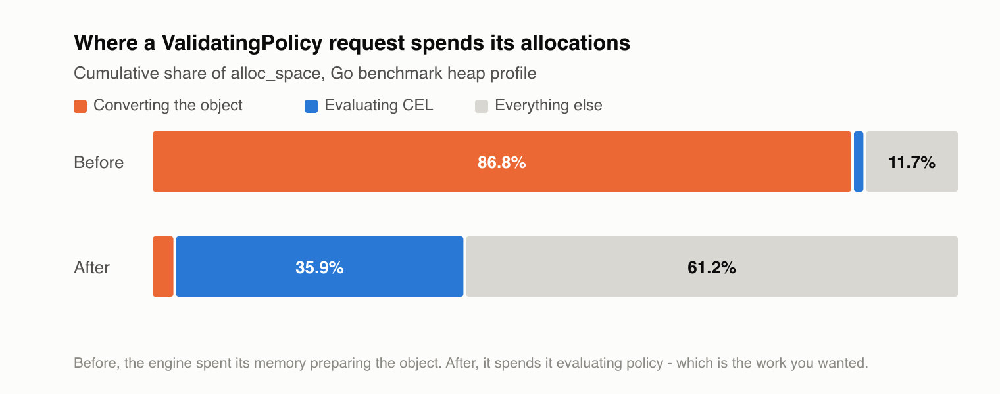
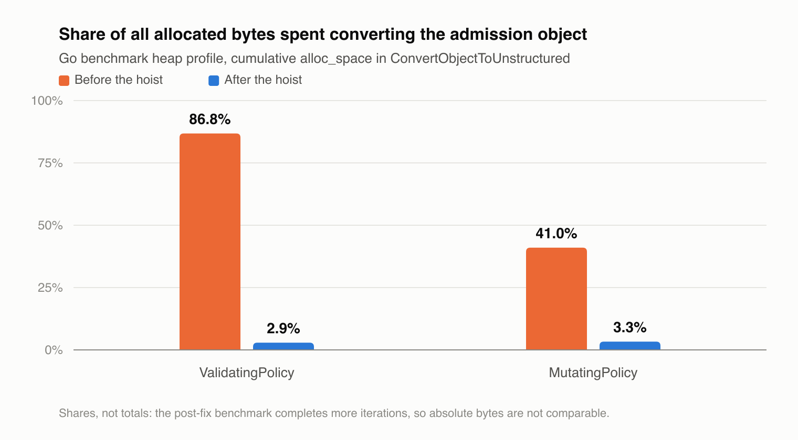
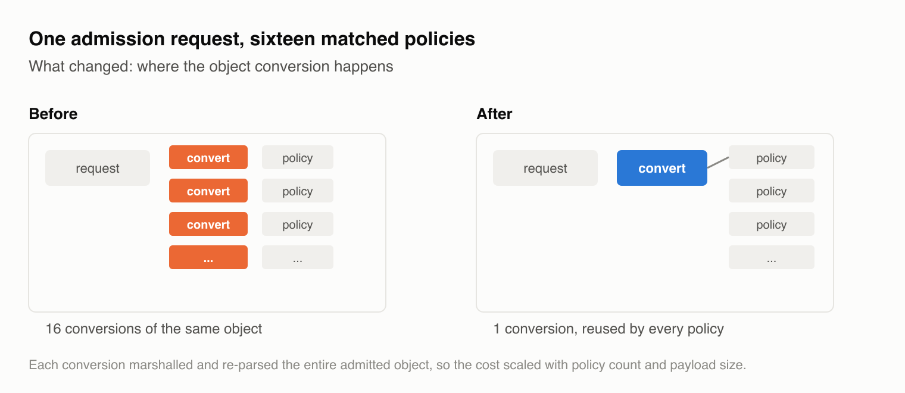
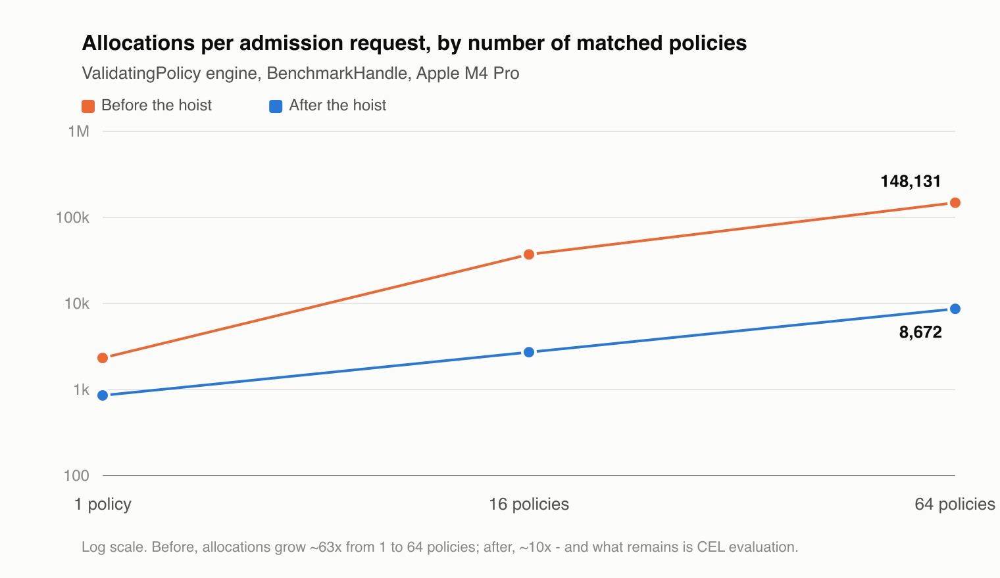
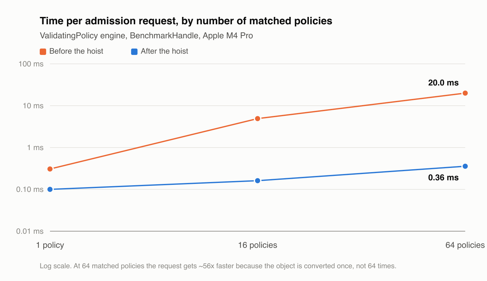
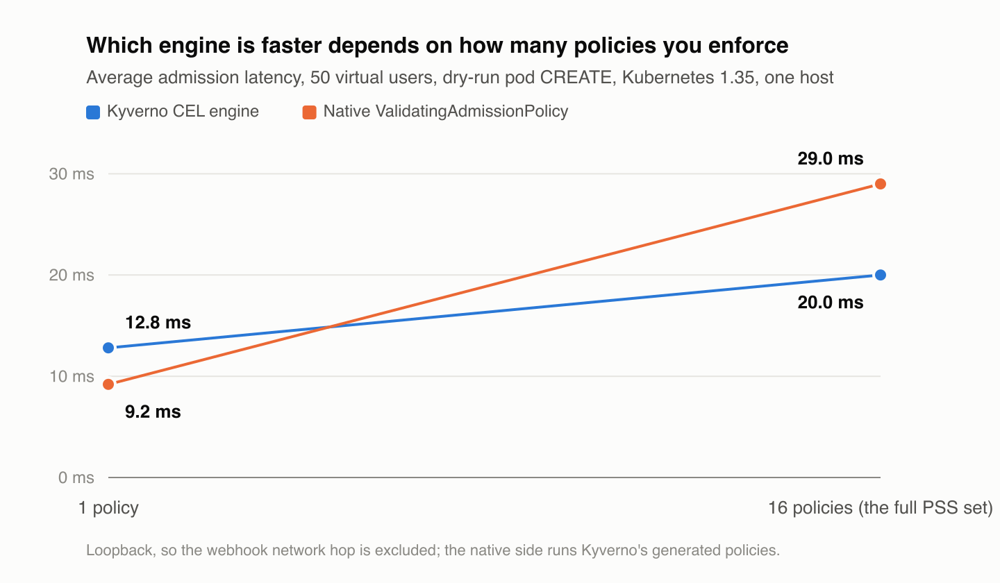
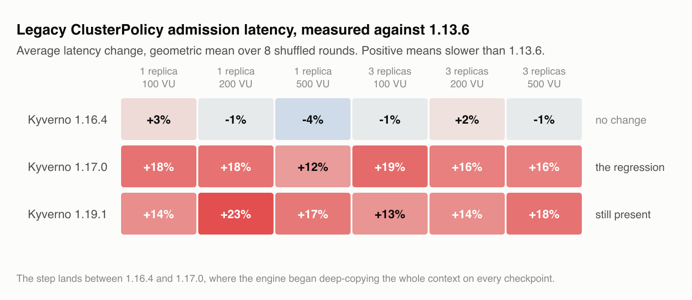

Kyverno's CEL (Common Expression Language) based engines exist to evaluate policy expressions. So when we profiled the admission path, we expected to find buk of the cost in CEL evaluation.

It was not there. **About 86% of what the engine allocated went into preparing the object for evaluation, and almost none of it into evaluating policy.**

We went looking because a public benchmark put Kyverno behind the alternatives. Those benchmarks measured the legacy `ClusterPolicy` JMESPath engine, which did have a real regression at the time, and the usual answer was to point people at the newer CEL-based engine instead. That answer was right and incomplete: but we had not checked what the CEL engine itself was spending its time on.

This post is about where that performance cost came from, why it grew with the number of policies you deploy, and what removing it did. The fix ships in Kyverno 1.19.2.

Please read the limitations section before you quote any number here. And as always, run your own tests in your environments, for real-world accuracy.

## What the profile showed

Kyverno's CEL engines evaluate policies against a CEL _activation_: a set of variables your policy expressions can reference. One of those variables is `request`, the `AdmissionRequest` the API server sent, converted into the unstructured map form CEL understands.

Here is a heap profile of the `ValidatingPolicy` engine handling admission requests, before and after the change, by share of total allocated bytes:

Before, `ConvertObjectToUnstructured` accounted for 86.8% of everything the engine allocated. CEL evaluation itself barely registered. After, object conversion falls to 2.9%, and the largest single frame becomes `evaluateWithData` — the code that actually runs your policy expressions.

The same pattern shows up in the `MutatingPolicy` engine, which was paying a smaller but still substantial version of the same cost:

One caveat on reading those profiles: the post-fix benchmark completes more iterations in the same time because it is faster, so the two profiles have different absolute totals. Compare the shares, not the raw bytes. Per-request figures come from the benchmark table further down.

## Why: the same object, converted once per policy

The API server sends the admitted object as raw JSON bytes. CEL cannot read bytes, so Kyverno parses them into the map form CEL understands before it can evaluate anything against them.

That conversion happened inside the loop over matched policies rather than before it. With the Pod Security Standards set, roughly 16 policies match a typical Pod creation — so Kyverno parsed the same Pod 16 times, same input, same output, every time. The cost grew with your policy count and with the size of the object being admitted: O(policies), where it should have been O(1).

The object does not change between policies. There was never a reason to convert it more than once.

## The fix: convert once per request

The change moves the conversion out of the per-policy loop. Kyverno builds the CEL `request` value once, before the loop starts, and every matched policy reuses it.

Doing that without changing what policies see takes some care. The expensive part of the conversion is the admitted object itself, so Kyverno converts a copy of the request with that object temporarily blanked out — which leaves only cheap fields to walk — and splices the object back in afterwards. The same conversion code still produces the result, so the output matches what policies saw before rather than being a reimplementation that someone has to keep in sync by hand.

### Keeping policy behavior identical

The first attempt used a single shared builder for every CEL engine. Testing caught that this quietly changed how policies behave, because the engines had never agreed on what `request.object` meant in the first place.

Validating and generating policies saw the object exactly as the API server sent it. Mutating policies saw a normalized version. The two also disagreed about what an empty object looks like to CEL, which matters for operations like DELETE where one side is absent.

Unifying them would have changed the result of expressions people already have deployed. That is a conversation worth having, but not one a performance fix should start on its own. So each engine keeps the contract it already had, sharing one fast implementation underneath.

Equivalence tests pin this down: they run the original code as the reference and compare its output against the new one field by field, across every request type, so any drift fails the build.

## What changed

The benchmark calls the engine directly with a roughly 50 KB Pod and a varying number of matched policies. It times the engine alone — building the `request` value, matching, and evaluating CEL. It does not include the webhook round trip, the API server, or etcd, so these are not end-to-end admission latencies.

| Matched policies | Allocations before | Allocations after | Engine time before | Engine time after |
| ---------------- | ------------------ | ----------------- | ------------------ | ----------------- |
| 1                | 2,327              | 854               | 0.31 ms            | 0.10 ms           |
| 16               | 37,055             | 2,718             | 4.91 ms            | 0.16 ms           |
| 64               | 148,131            | 8,672             | 20.01 ms           | 0.36 ms           |

The `MutatingPolicy` engine improves on the same curve, from 258,943 to 52,689 allocations and 10.59 ms to 2.97 ms at 64 policies.

The slope is the point, not the headline multiple. Before the change, allocations grew about 63 times going from 1 policy to 64. After, about 10 times — and that residual growth is CEL evaluation, which is the work you deployed the policies to get. Object preparation is now constant per request instead of proportional to how many policies you run.

Practically: adding policies to a Kyverno deployment used to carry a hidden per-policy serialization cost on top of the evaluation you asked for. It no longer does.

## Image verification too

The image verification engine had the same pattern, with its own private copy of the conversion code, so it got the same fix. The gain there is memory rather than speed: image verification spends most of its time fetching signatures and attestations over the network, and that part does not change.

## How this compares to native admission policies

With the per-policy tax gone, it is worth asking where Kyverno's CEL engine actually sits against the API server's own `ValidatingAdmissionPolicy`.

Running the same 16 Pod Security Standards policies through both engines on one cluster, the answer depends on how many policies you enforce:

At one policy, native is ahead: about 9.2 ms against Kyverno's 12.8 ms. At the full 16-policy set, Kyverno is ahead: about 20 ms against native's 29 ms.

Those numbers were measured on Kyverno 1.19.0, which predates the change described above. The Kyverno side of that chart should now be better than shown; we have not re-run the comparison.

The two engines pay their costs differently. Native dispatches each policy separately on the API server, so its cost grows with the number of policies you enforce. Kyverno pays once per request to receive the object over a webhook, and that cost is shared across however many policies then evaluate. With only a policy or two, native is ahead. Once you are running a realistic set, Kyverno matches it and can come out ahead.

That framing only became accurate with this fix. Kyverno's cost was not fixed per request before it — it was per policy, which is exactly why the curve looked the way it did.

The CPU side is more one-sided. Under matched load, Kyverno's engine used about 3.2 cores against the API server's 8.2 for native. The surprise in the API server profile is that 67% of its CPU sits in the policy dispatch machinery while the actual CEL bytecode execution is about 5.5% — the cost is dispatching 16 policies and building an input for each, not evaluating them. And that load lands on the control plane, which you cannot scale horizontally the way you can scale a Kyverno deployment.

Both numbers come from a single-host setup where the webhook hop is loopback and effectively free. On a real multi-node cluster that hop costs real latency on every Kyverno request, which narrows the latency gap and matters most at low policy counts. The CPU finding does not depend on topology.

## The legacy engine, briefly

The benchmarks that prompted this work measured `ClusterPolicy`, the older non-CEL engine, so it is worth saying what happened there.

We reproduced the regression across four releases, each on a fresh cluster, run in shuffled order over eight rounds so no version was systematically favored, and compared everything against 1.13.6.

The regression is real — between 12% and 23% depending on load — and it appears between 1.16.4 and 1.17.0. That is where the engine started copying its entire evaluation context on every checkpoint, in order to fix a separate bug where one rule's data could leak into the next.

The fix keeps that guarantee but stops paying for it upfront: it takes a shallow snapshot and only copies a value when something actually writes to it. The benchmark returns to roughly its pre-regression level, and the rule isolation still holds, pinned by a test that fails on the old code.

This ships in 1.19.2 alongside the CEL work, and only there. The legacy engine is on its way out, so the effort belongs in the engine replacing it.

## What this does not fix

- The engine still pays one JSON round-trip of the admitted object per request, to preserve the raw, un-normalized parse that `request.object` has always exposed. Evaluating against the typed object, or a cheaper representation, would remove even that — but it would change what policies see, so it needs its own design.
- Mutating policies thread full objects between policies rather than propagating a patch diff. A patch-only model is a substantially larger redesign and is not implemented.
- Tail latency under sustained load on a single replica is not addressed by any of this, and we have not re-measured it since. If you have seen Kyverno's p95 swing widely between runs at high load, that is a separate problem and it is still open.

## Limitations

- **Single machine.** Everything here reproduces the _relationship_ between configurations, not the absolute numbers you would see on a 32-core server.
- **Most of this is a Go benchmark.** The allocation and timing figures come from benchmarks driving the real engine loop, and the profiles come from those benchmark runs. They isolate the engine cleanly, and they exclude network, serialization at the webhook boundary, and etcd.
- **The engine comparison uses loopback,** so the webhook network hop is excluded, and dry-run, so the etcd write is excluded.
- **The native side runs Kyverno's generated policies,** which is a faithful same-policy comparison rather than a hand-tuned native policy set.
- Side controllers were disabled in these runs. Only the admission controller was active.

## Reproduce it

The harness is in the Kyverno repository under `docs/perf-testing/`: the version ladder, the pinned Pod Security Standards policy set, the k6 scripts, and the cluster setup. The engine benchmarks live beside the code they measure, in `pkg/cel/policies/vpol/engine` and `pkg/engine/context`.

If you benchmark Kyverno and get a result you do not like, please publish it — with the method, the caveats, and the per-trial numbers. That is how this work started.

## Thanks

Thanks to [Mert Erdinç](https://merdincz.com/en/comparing-kubernetes-policy-engines/), whose careful, well-documented comparison of policy engines prompted us to go looking.

## References

- [#17572](https://github.com/kyverno/kyverno/pull/17572) — build the request activation once per admission request
- [#17585](https://github.com/kyverno/kyverno/pull/17585) — hoist the request-map build in the image verification engine
- [#17565](https://github.com/kyverno/kyverno/pull/17565) — reduce engine context checkpoint copy cost
