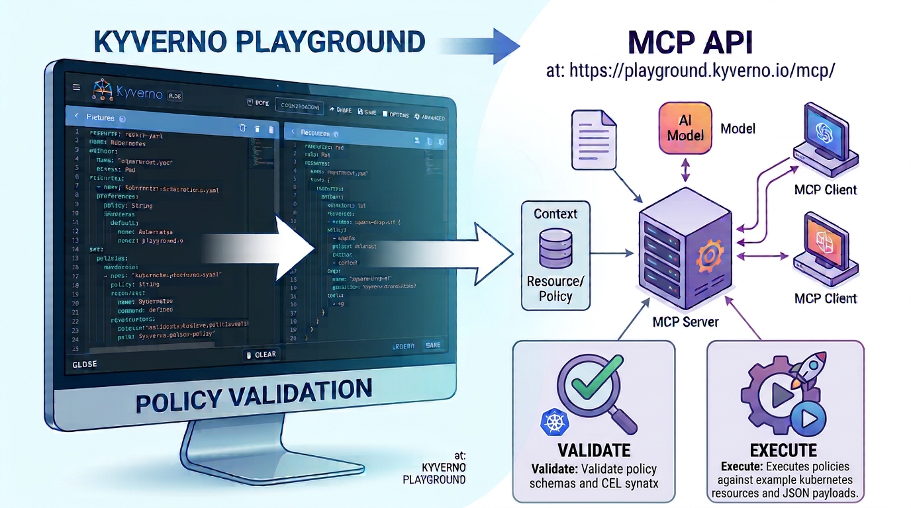

# From Playground to MCP: Bringing Kyverno Policy Testing into AI Workflows

When a policy is written or changed, the next question is always the same: does it behave the way we expect?

For years, the Kyverno Playground has helped answer that question in a visual, approachable way. As more people turn to AI to draft Kyverno policies or migrate older policy types to CEL-based policies, there is a new opportunity: make policy testing accessible not only through a graphical interface, but also directly from AI tools.

## A playground without a cluster

The Kyverno Playground was first released on May 14, 2023. It provides a graphical interface with inline editors for simulating how Kyverno policies apply to example resources. No Kubernetes cluster is required, and dynamic values can be mocked.

That makes the Playground useful in several situations: auditing policies, presenting Kyverno, or giving new and prospective users a place to experiment. Users can focus on the policy and the resource it acts on, without first setting up a cluster and installing required software.

## Policy authoring is changing

AI is becoming part of how people work with Kyverno policies. Some users ask AI to draft a policy from a natural-language requirement. Others use it to migrate deprecated `Policy` and `ClusterPolicy` definitions to newer CEL-based policy types.

Generated and migrated policies still need to be checked. Yet free tools for testing them are limited, and a graphical playground can be cumbersome when the policy is being created inside an AI-assisted workflow. Moving between a chat, an editor, and a separate web interface adds friction to a task that should be easy to validate.

## Making existing tools accessible to AI

This is where the Model Context Protocol (MCP) can help. MCP gives AI applications a standard way to interact with external tools and services. Rather than asking users to copy a generated policy into a separate interface, an MCP-enabled tool can make existing capabilities available from within the AI workflow.

The idea is not to replace the Playground's interface. It is to make policy evaluation easier to reach in the moments when you need it: while drafting, revising, or migrating a policy with AI. The graphical Playground remains valuable for exploration and learning; an MCP interface offers another path for calling on the same kind of tooling.

The public MCP server at `https://playground.kyverno.io/mcp/` exposes two tools. `validate` checks policies against Kyverno's CRD schema and API definition, without evaluating them against resources. `execute` runs policies against supplied Kubernetes resources and returns results such as Pass, Fail, Warn, Skip, or Error. It also accepts optional inputs such as previous resources for update requests, simulated preexisting cluster resources for lookups, Custom Resource Definitions, and mocked variables. This lets an AI client choose between a quick policy check and a full policy evaluation with test data.

## Beyond policy testing: compliance with Policy Reporter MCP

Testing a draft policy is only one part of working with policy results. In a running cluster, users may also want to ask questions such as, "How many failing policies does the `kube-system` namespace have?" An AI could answer by retrieving every report through the Kubernetes API and summarizing them, but repeating that work for each question creates unnecessary API traffic and leaves the model to do the aggregation.

Policy Reporter MCP can answer these questions from Policy Reporter's internal representation of the current report state. It queries the existing database, where optimized read schemas and SQL aggregation can handle larger report sets without fetching each report from the Kubernetes API for every request. Its tools cover four levels of investigation:

- `get_namespace_compliance_summary` returns status and severity counts by namespace and reporting source.
- `list_resource_compliance` summarizes pass, warn, fail, error, and skip results for resources in selected namespaces.
- `get_resource_compliance_results` returns the individual policy and rule results for one resource.
- `list_policy_results` lists individual results for selected policies, with filters and pagination.

Together, the two MCP servers address different stages: the Playground helps test a policy draft against supplied resources, while Policy Reporter helps explore compliance reports already collected from a cluster.

## Two complementary feedback loops

AI can help draft or migrate a policy, but the work does not end with generating YAML. The Playground MCP supports the next step: validate a policy or execute it against example resources, without requiring a Kubernetes cluster. Once policies are running in a cluster, Policy Reporter MCP supports a different question: what do the reports say about compliance right now?

Together, these tools connect policy authoring with both pre-deployment testing and post-deployment observability. An AI assistant can help users iterate on a draft, then query summarized or detailed results from reports already collected by Policy Reporter, without retrieving every report from the Kubernetes API for each question. The two MCP servers bring existing Kyverno capabilities into AI workflows while keeping their roles distinct: one tests policies; the other helps explain reported outcomes.
